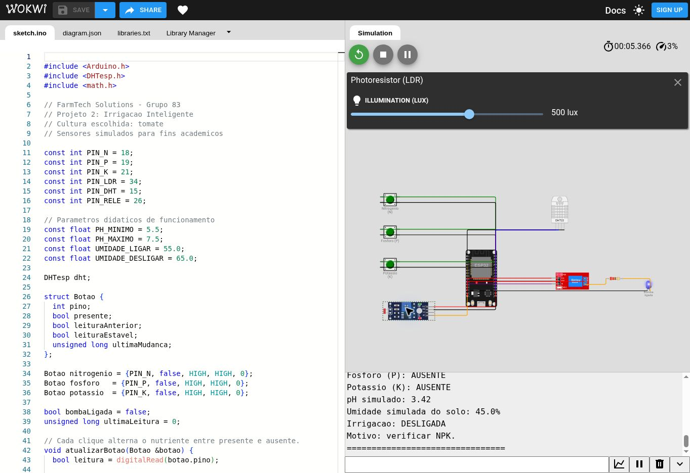
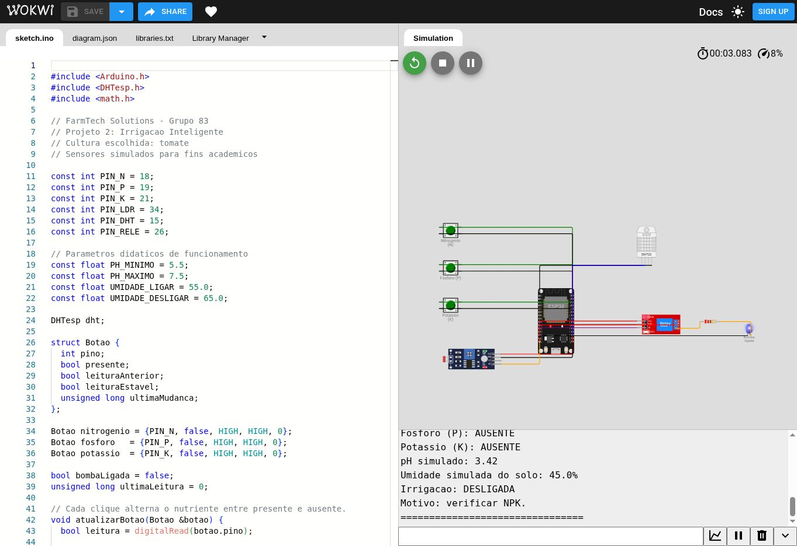

# FarmTech Solutions — Irrigação Inteligente

**FIAP · Projeto 2 — Iniciando a Coleta de Dados · Grupo 83**  
**Cultivo escolhido: tomate**

Protótipo de irrigação com ESP32 que reúne entradas simuladas de nutrientes, pH e umidade para decidir quando acionar um relé. O projeto demonstra a coleta de dados e a tomada de decisão em um sistema embarcado aplicado à agricultura.

**[Abrir o circuito no Wokwi](https://wokwi.com/projects/477646034464742401)**

## Objetivo

Representar o monitoramento de uma área de cultivo de tomate e automatizar o acionamento da irrigação a partir de condições previamente definidas. O sistema permite observar como mudanças nas entradas alteram a decisão do controlador e acompanhar os dados pelo monitor serial.

O protótipo é acadêmico: os componentes disponíveis no simulador representam grandezas agrícolas, sem realizar análises reais do solo. Os limites adotados são didáticos e não constituem recomendação agronômica para o tomate.

## Cultivo escolhido e necessidades do tomate

O tomate foi escolhido para relacionar a disponibilidade de nutrientes, as condições químicas do solo e o manejo da água. A pesquisa de referência utiliza publicações da Embrapa sobre tomate para industrialização, um contexto de produção em lavoura.

| Fator | Necessidade real da cultura | Representação no protótipo |
| --- | --- | --- |
| Nitrogênio (N) | Sua deficiência reduz o crescimento; a exigência é importante nos primeiros estádios de desenvolvimento. [1] | Estado binário de presença ou ausência, alterado pelo botão N. |
| Fósforo (P) | Sua deficiência prejudica o crescimento e pode atrasar a frutificação. Sua absorção depende também da acidez e da umidade do solo. [1] | Estado binário alterado pelo botão P. |
| Potássio (K) | É o nutriente mais extraído pelo tomateiro; sua deficiência pode prejudicar o crescimento e a firmeza dos frutos. [1] | Estado binário alterado pelo botão K. |
| pH | A acidez interfere na disponibilidade e na absorção de nutrientes. A correção do solo depende de análise química. [2] | Leitura do LDR convertida para a escala de 0 a 14. |
| Água | O manejo deve evitar estresse hídrico, especialmente no florescimento e no crescimento dos frutos, e áreas sujeitas a encharcamento. [1][2] | Umidade do DHT22 usada como entrada didática para ligar e desligar a irrigação. |

Como referência quantitativa, a Embrapa apresenta teores adequados em **análise foliar** de 4,0–6,0% de N, 0,25–0,75% de P e 3,0–5,0% de K, dentro do protocolo de amostragem descrito na publicação. São concentrações nas folhas, não percentuais de umidade nem leituras dos botões. O manejo de adubação considera diagnóstico nutricional, características do solo e histórico da área; não existe uma dose única que os três estados booleanos consigam representar. [3]

Essa pesquisa fundamenta a escolha das variáveis monitoradas. Para demonstrar a decisão no simulador, o grupo adotou a combinação de NPK presente, pH permitido e umidade baixa. A faixa de **pH 5,5–7,5** e os limiares de **55% e 65%** são escolhas de programação: não foram obtidos por calibração agrícola nem equivalem às recomendações quantitativas de adubação da Embrapa. A regra de bloquear a irrigação com nutriente ausente também é uma simplificação do exercício.

## Organização do projeto

| Arquivo ou pasta | Conteúdo |
| --- | --- |
| [sketch.ino](sketch.ino) | Código C/C++ original do projeto Wokwi, para ESP32 com framework Arduino. |
| [diagram.json](diagram.json) | Componentes, posicionamento, conexões e configurações originais do circuito. |
| [libraries.txt](libraries.txt) | Dependência utilizada pelo simulador: DHT sensor library for ESPx. |
| [docs/testes.md](docs/testes.md) | Procedimento de reprodução, cenários e registro da execução observada. |
| [docs/imagens](docs/imagens) | Capturas reais da interface do Wokwi. |
| [docs/registros/monitor-serial.txt](docs/registros/monitor-serial.txt) | Saída do monitor serial capturada durante a execução. |
| [docs/roteiro-video.md](docs/roteiro-video.md) | Sequência sugerida para apresentar o funcionamento do protótipo. |

Os três arquivos do circuito foram extraídos do [projeto original](https://wokwi.com/projects/477646034464742401), mantendo seu conteúdo e suas conexões.

## Componentes e representação dos sensores

| Quantidade | Componente | Função no projeto |
| --- | --- | --- |
| 1 | ESP32 DevKit V1 | Leitura das entradas, aplicação das regras e controle da saída. |
| 3 | Botões verdes | Representam a presença ou ausência de nitrogênio (N), fósforo (P) e potássio (K). |
| 1 | Módulo LDR | Fornece um sinal analógico convertido para uma escala didática de pH. |
| 1 | DHT22 | Sua leitura de umidade representa a umidade do solo no exercício. |
| 1 | Módulo relé, configurado como PNP | Comuta a saída que representa a irrigação. |
| 1 | LED azul | Indica o acionamento da bomba simulada. |
| 1 | Resistor de 220 Ω | Ligado em série com o LED indicador. |

O DHT22 mede umidade relativa do ar em sua aplicação real; não é um sensor de umidade do solo. O LDR responde à luz e não mede pH. Os botões não medem concentração de nutrientes. A bomba é representada pelo conjunto relé, resistor e LED, sem bomba hidráulica ou circulação de água.

## Conexões

| Componente / terminal | Ligação no ESP32 ou no circuito |
| --- | --- |
| Botão N: `1.l` / `2.l` | GPIO 18 / GND.1 |
| Botão P: `1.l` / `2.l` | GPIO 19 / GND.1 |
| Botão K: `1.l` / `2.l` | GPIO 21 / GND.1 |
| LDR: AO / VCC / GND | GPIO 34 / 3V3 / GND.1 |
| DHT22: SDA / VCC / GND | GPIO 15 / 3V3 / GND.2 |
| Relé: IN / VCC / GND | GPIO 26 / VIN / GND.2 |
| Relé: COM | VIN do ESP32 |
| Relé: NO | Terminal 1 do resistor de 220 Ω |
| Resistor: terminal 2 | Ânodo do LED azul |
| LED: cátodo | GND.2 |
| ESP32: TX0 / RX0 | RX / TX do monitor serial |

Os botões usam `INPUT_PULLUP`: em repouso, a entrada fica em nível alto; pressionados, conectam a entrada ao terra. Não há resistor externo de pull-up nesses botões. O terminal digital do módulo LDR não é utilizado.

## Funcionamento do programa

Na inicialização, os três nutrientes estão no estado **ausente** e a irrigação está **desligada**. Cada pressão reconhecida de um botão alterna o estado lógico do respectivo nutriente. O estado permanece após soltar o botão e é reiniciado quando a simulação recomeça.

Assim, os nutrientes continuam sendo representados por `true` ou `false`, mas o código usa **alternância por clique**: o estado armazenado do nutriente não corresponde continuamente à posição física pressionada ou solta do botão. Essa implementação permite operar os três botões em sequência.

A função `atualizarBotao()` trata a estabilização da entrada por mais de 35 ms. O `loop()` verifica os botões continuamente, com uma pausa de 10 ms, e chama `controlarIrrigacao()` a cada 2.000 ms de tempo simulado.

A leitura analógica usa resolução de 12 bits, de 0 a 4095. A conversão adotada é:

```text
pH simulado = leitura analógica × 14,0 / 4095,0
```

Essa transformação cria uma escala de 0 a 14 para o exercício; não é uma calibração de sensor químico. O controle usa o valor calculado completo, embora o monitor exiba o pH com duas casas decimais.

O programa utiliza apenas a umidade retornada pelo DHT22. A temperatura está disponível no componente, mas não participa das decisões. As mensagens são transmitidas a **115200 baud**, com NPK, pH, umidade, estado da irrigação e motivo da decisão.

## Regras de decisão

| Condição | Resultado |
| --- | --- |
| Leitura de umidade inválida (`NaN`) | Desliga a irrigação. |
| Pelo menos um nutriente ausente | Desliga a irrigação. |
| pH abaixo de 5,5 ou acima de 7,5 | Desliga a irrigação. |
| NPK presente, pH entre 5,5 e 7,5, umidade válida e menor que 55% | Liga a irrigação. |
| NPK presente, pH permitido e umidade de 65% ou mais | Desliga a irrigação. |
| NPK presente, pH permitido e umidade de 55% a menos de 65% | Mantém o estado anterior. |

Os limites de pH são inclusivos. A faixa entre 55% e 65% implementa **histerese**, evitando que pequenas oscilações da umidade provoquem acionamentos sucessivos. Em 55%, a bomba mantém seu estado; em 65%, desliga.

Os bloqueios têm prioridade sobre a histerese. Se um nutriente ficar ausente ou o pH sair da faixa, a saída desliga na próxima avaliação. Se a condição for corrigida enquanto a umidade estiver em 60%, a saída continua desligada até a umidade cair abaixo de 55%.

O relé PNP recebe `HIGH` para acionar e `LOW` para desligar. Quando acionado, seu contato normalmente aberto fecha o caminho de alimentação do LED azul.

## Como executar

1. Abra o [projeto no Wokwi](https://wokwi.com/projects/477646034464742401).
2. Confira as abas `sketch.ino`, `diagram.json` e `libraries.txt`.
3. Clique em **Start the simulation** e acompanhe o monitor serial.
4. Pressione os botões N, P e K uma vez cada e confira se os três aparecem como `PRESENTE`. Se a simulação estiver lenta, mantenha cada botão pressionado por tempo suficiente para a estabilização da entrada.
5. Clique no LDR e ajuste a iluminação até que o pH exibido fique dentro da faixa permitida. A iluminação está em lux; o pH correspondente deve ser acompanhado no monitor serial.
6. Clique no DHT22 e ajuste **Humidity** para experimentar valores abaixo de 55%, entre os limites e a partir de 65%.
7. Aguarde uma nova leitura antes de avaliar cada resultado. O intervalo de dois segundos refere-se ao tempo da simulação, que pode avançar mais devagar que o relógio real.

### Alteração conjunta de NPK e pH

Durante a demonstração proposta pela atividade, **ao mudar um estado de NPK, ajuste também o LDR manualmente**, representando uma mudança nas condições químicas do solo. Os botões não modificam o LDR por software: são entradas independentes. Não existe uma fórmula no projeto que determine o pH a partir dos três booleanos.

Por exemplo, com umidade de 45%, alterne N para ausente e ajuste o LDR para um pH próximo de 5,0. Depois restaure N e ajuste o pH para aproximadamente 6,5, mantendo P e K presentes. Observe cada atualização no monitor serial. Para demonstrar especificamente o bloqueio por NPK, varie o pH entre dois valores dentro da faixa permitida, como 6,2 e 6,5, enquanto altera um nutriente. Esses valores são entradas de teste e não uma previsão da reação química causada por cada nutriente.

Também é possível reproduzir o projeto em um ambiente Wokwi para ESP32 usando os três arquivos da raiz, juntos e sem alterar as conexões. A biblioteca declarada em `libraries.txt` fornece o cabeçalho `DHTesp.h`; não deve ser substituída por outra biblioteca DHT com interface diferente.

## Cenários de teste e evidências

O [documento de testes](docs/testes.md) detalha os cenários de ativação, desativação, bloqueio por NPK, bloqueio por pH e manutenção de estado pela histerese.

Na execução registrada, o projeto compilou e iniciou no Wokwi. O monitor apresentou **N, P e K ausentes, pH 3,42, umidade 45,0% e irrigação desligada**, com a mensagem `Motivo: verificar NPK.`. A saída capturada está em [monitor-serial.txt](docs/registros/monitor-serial.txt). Esse registro comprova a inicialização e o bloqueio no estado inicial; não comprova isoladamente todos os cenários descritos.

### Circuito e ajuste do LDR



### Irrigação bloqueada no estado inicial



## Limites do protótipo

- A faixa de pH e os percentuais de umidade são parâmetros didáticos. A aplicação em uma lavoura exigiria sensores apropriados, calibração e critérios definidos para solo, clima, estágio do cultivo e manejo.
- A presença de NPK é uma entrada binária. Não há concentração em mg/kg, dosagem de fertilizante ou correção automática de nutrientes e pH.
- O bloqueio por NPK é uma regra do exercício; não representa uma regra universal de manejo de irrigação.
- O programa detecta umidade `NaN`, mas não implementa diagnóstico completo de sensores desconectados, leituras congeladas ou falhas do atuador. O LDR não possui verificação própria de falha.
- Não há medição de vazão, reservatório, consumo de água ou confirmação física do funcionamento da bomba. O LED indica o acionamento elétrico simulado.
- Na faixa de histerese, a mensagem `solo com umidade baixa` pode continuar aparecendo enquanto a saída permanece ligada, mesmo após a umidade atingir 55%. A decisão depende também do estado anterior.
- As leituras são exibidas no monitor serial. Não há banco de dados, armazenamento persistente, API meteorológica, implementação em Python ou análise em R neste escopo.

## Referências

[FarmTech Solutions — Grupo 83, circuito original no Wokwi](https://wokwi.com/projects/477646034464742401).

1. EMBRAPA HORTALIÇAS. **Cultivo de tomate para industrialização: deficiências nutricionais**. Sistemas de Produção, 1, 2ª edição, dez. 2006. [Publicação](https://sistemasdeproducao.cnptia.embrapa.br/FontesHTML/Tomate/TomateIndustrial_2ed/deficiencias.htm). Acesso em: 12 out. 2026.
2. EMBRAPA HORTALIÇAS. **Cultivo de tomate para industrialização: solos**. Sistema de Produção, 1, jan. 2003. [Publicação](https://sistemasdeproducao.cnptia.embrapa.br/FontesHTML/Tomate/TomateIndustrial/solos.htm). Acesso em: 12 out. 2026.
3. EMBRAPA HORTALIÇAS. **Cultivo de tomate para industrialização: adubação**. Sistemas de Produção, 1, 2ª edição, dez. 2006. [Publicação](https://sistemasdeproducao.cnptia.embrapa.br/FontesHTML/Tomate/TomateIndustrial_2ed/adubacao.htm). Acesso em: 12 out. 2026.
